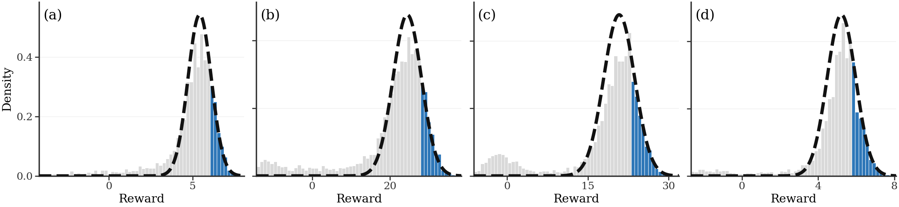

# Scaling-Law Guided (SLG) Search

**Official implementation of [Predicting and Improving Test-time Scaling Laws via Reward Tail-guided Search](https://arxiv.org/abs/2602.01485)**

Muheng Li, Jian Qian, Wenlong Mou · **NeurIPS 2026**

[Paper](https://arxiv.org/abs/2602.01485) · [Quick start](#quick-start) · [Configuration](docs/CONFIGURATION.md) · [Experiments](docs/EXPERIMENTS.md) · [Extending the framework](docs/EXTENDING.md)

SLG allocates an LLM's sampling budget using the upper tail of the reward distribution. It samples candidate continuations, estimates which intermediate states have the greatest potential at a larger budget, and spends the remaining samples on the selected state. The returned answer is the highest-reward response observed during the search.

The implementation includes **SLG, Best-of-N, Branching BoN, mean-guided search, and tree-structured SLG**, with shared model, task, and evaluation interfaces. The entry point is [`main.py`](main.py).

## Why the reward tail?



Four selected prompt-level examples from WildBench v2, Arena-Hard, and AlpacaEval. Gray bars show the reward distribution, blue bars highlight the upper 20%, and dashed curves show the Gaussian tail fit. Each panel uses 5,000 sampled responses. These examples illustrate the motivation for fitting the reward tail; they are not aggregate search-performance results.

## Quick start

Use Python 3.11. From a fresh checkout:

```bash
git clone https://github.com/PotatoJnny/Scaling-Law-Guided-search.git
cd Scaling-Law-Guided-search
python -m venv .venv
source .venv/bin/activate
python -m pip install -r requirements-demo.txt
python examples/toy_search.py
```

The CPU example runs the actual `SLG_Search` implementation with a synthetic generator and reward function. It needs no GPU, model download, or dataset. It prints the selected state's statistics, best response, and `total_rollouts: 96`, and checks that the sampling budget and best observed reward agree with the returned result.

## Run with language and reward models

From the repository root, install the model runtime:

```bash
python -m pip install -r requirements.txt
python main.py --config configs/slg_alpaca_eval.json --num_problems 2
```

This example uses `Qwen/Qwen3-8B`, `Skywork/Skywork-Reward-V2-Llama-3.1-8B`, and AlpacaEval with a budget of 64 sampled continuations per prompt. The generator and reward model run on the same GPU; the example follows the project's single-H100 hardware profile. See the [configuration guide](docs/CONFIGURATION.md) for memory and batching settings.

Run Best-of-N with the same models, prompts, generation settings, and budget:

```bash
python main.py --config configs/best_of_n_alpaca_eval.json --num_problems 2
```

Remove `--num_problems 2` to process the full dataset. Model weights and datasets are downloaded or read from their local caches. These example runs write separate directories under `data/results/examples/`.

Benchmark-native evaluation uses additional benchmark tools and, where applicable, judge credentials; see [experiments and evaluation](docs/EXPERIMENTS.md).

## How SLG works

1. **Explore:** sample responses at the root and construct candidate prefix states.
2. **Estimate:** sample continuations from each candidate and fit its upper reward tail.
3. **Allocate:** compare predicted potential and spend the remaining rollout budget on the selected state. The current one-layer implementation also allows selecting the root.
4. **Return:** choose the highest-reward complete response observed across all stages.

The Gaussian-tail value estimator uses

$$
\widehat V_N(s) = \widehat\mu_s + \widehat\sigma_s\,\Phi^{-1}(1 - 1/N),
$$

where the distribution parameters are estimated from the upper tail. See [`Node.evaluate_value`](core/data_structures.py) for the estimator and [`SLG_Search`](algorithms/slg_mcts.py) for budget allocation.

`N` counts generated continuations, including root and exploration samples. `K` controls the number of candidate states; `m` controls root sampling and per-state exploration. Setting `K` or `m` to `-1` uses the configured automatic rule. Full parameter details are in the [configuration guide](docs/CONFIGURATION.md).

## Repository layout

| Path | Purpose |
| --- | --- |
| [`main.py`](main.py) | Run a JSON-configured experiment |
| [`algorithms/`](algorithms/) | Search methods and shared algorithm interface |
| [`core/`](core/) | States, tail estimator, model engines, reward engines, and runtime configuration |
| [`tasks/`](tasks/) | Datasets, prompt formatting, response parsing, and task metrics |
| [`evaluation/`](evaluation/) | Per-prompt results and aggregate summaries |
| [`configs/`](configs/README.md) | Runnable examples and experiment defaults |
| [`examples/`](examples/) | CPU example using the real search algorithm |
| [`experiments/`](experiments/) | Reward-tail analysis and search benchmark workflows |
| [`scripts/`](scripts/) | Optional model download utilities |
| [`docs/`](docs/) | Configuration, experiment, and extension guides |

Large run outputs, model caches, local environments, and working research notes live outside the tracked source. Existing experiment scripts are indexed in the [experiment guide](docs/EXPERIMENTS.md), including the inputs they require.

## Results

`main.py` saves `results.json` in the configured `output_dir`. It contains the resolved experiment configuration, aggregate summary, and per-prompt responses, reward scores, rollout counts, timing, and task metrics. It is updated as prompts finish.

The search experiment runner additionally writes `final_summary.json` after its generation and evaluation workflow finishes. Check `official_eval_status` to see whether benchmark-native evaluation completed or was deferred. Reward-model scores and official benchmark scores are reported separately.

## Development

From the repository root:

```bash
make check
```

This runs the CPU search example and checks CLI help. To add a dataset, reward function, or search method, start with the [extension guide](docs/EXTENDING.md).

## Citation

```bibtex
@inproceedings{li2026predicting,
  title     = {Predicting and Improving Test-time Scaling Laws via Reward Tail-guided Search},
  author    = {Li, Muheng and Qian, Jian and Mou, Wenlong},
  booktitle = {Advances in Neural Information Processing Systems},
  year      = {2026},
  url       = {https://arxiv.org/abs/2602.01485}
}
```
